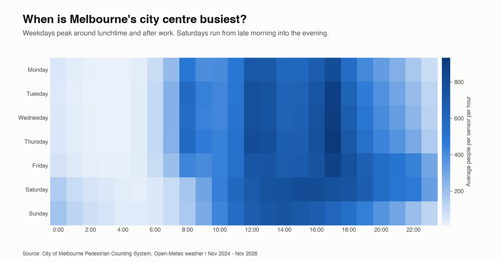
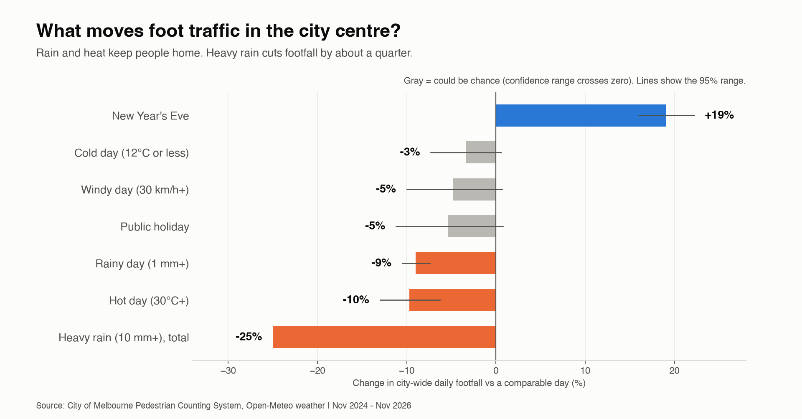

# Does rain empty Melbourne's city centre?

An end-to-end analytics project on **1.6 million hourly foot-traffic readings from 134 City of Melbourne street sensors** (Nov 2024 to Nov 2026), combined with weather and Victorian public holidays. It uses **dbt + DuckDB** for a tested data pipeline, a regression to explain what moves footfall, and a forecasting model to predict daily footfall.

**Live dashboard:** [Tableau Public](https://public.tableau.com/app/profile/krupa.ashoka/viz/DoesrainemptyMelbournescitycentre/DoesrainemptyMelbournescitycentre)

## Key findings
| What | Effect on city-wide daily footfall |
|---|---|
| Rainy day (1 mm+) | **-9%** (95% range -10.5% to -7.4%) |
| Heavy rain (10 mm+) | **about -25% in total** (rainy-day effect plus a further -18%) |
| Hot day (30°C+) | **-10%** (-13% to -6%) |
| New Year's Eve | **+19%** (+16% to +22%) |
| Public holiday, windy day, cold day | small or uncertain (confidence range crosses zero) |

Friday and Saturday are the busiest days; Monday and Sunday the quietest. Weekdays peak around lunchtime and about 5pm.

**Forecasting:** a gradient-boosting model predicted daily footfall for **120 days it had never seen** with an **average error of 6.6%**, versus 9.1% for the simple "usual number for that weekday" guess.

> These are associations from two years of data in one city, not proof of cause. The model missed storm days such as 25 Oct 2026 (32.6 mm of rain), which were more extreme than anything common in training.




## How it works
```
download_data.sh -> scripts/load_raw.py -> dbt (staging -> marts + 14 tests) -> model_footfall.py -> make_charts.py / Tableau
```

| Layer | Models |
|---|---|
| Staging (views) | `stg_footfall_hourly`, `stg_sensors`, `stg_weather_hourly` |
| Seeds | `calendar_events` (Victorian public holidays, New Year's Eve; checked against Business Victoria) |
| Marts (tables) | `dim_date`, `dim_sensor`, `fct_footfall_hourly`, `fct_city_daily` |

### Data-quality decisions
- **Core sensors only** for city totals: sensors that reported on at least 95% of days, so totals aren't distorted by sensors being installed or breaking.
- **Complete days only**: a partial final day (about 5,000 people instead of about 800,000) made the first model's error 132%. A coverage rule and a dbt test now prevent this.
- **Unregistered sensors**: two sensors (IDs 28 and 78) send data but are missing from the official sensor list. A dbt `relationships` test caught it; they are labelled, not dropped.
- **Duplicates** in the raw hourly file are removed in staging.

## Run it yourself
```bash
python3 -m venv .venv && source .venv/bin/activate
pip install -r requirements.txt
./download_data.sh                     # downloads raw data (about 30 seconds)
python scripts/load_raw.py             # loads it into DuckDB
dbt seed --profiles-dir .
dbt run  --profiles-dir .
dbt test --profiles-dir .              # 14 tests
python scripts/model_footfall.py       # writes results/metrics.json
python scripts/make_charts.py          # writes charts/*.png
python scripts/export_for_tableau.py  # writes tableau_data/*.csv
python scripts/build_tableau_workbook.py  # builds the Tableau workbook (needs Tableau Public to open)
```

## Tableau
**[View the interactive dashboard on Tableau Public](https://public.tableau.com/app/profile/krupa.ashoka/viz/DoesrainemptyMelbournescitycentre/DoesrainemptyMelbournescitycentre)**: headline numbers plus six charts (weekday-by-hour heatmap, what moves footfall, busiest days, weather buckets, daily trend, busiest streets). It is generated from the CSV files in `tableau_data/` by `scripts/build_tableau_workbook.py`.

## Data sources
- [City of Melbourne Open Data: Pedestrian Counting System](https://data.melbourne.vic.gov.au/)
- [Open-Meteo Historical Weather API](https://open-meteo.com/) (Melbourne, hourly)
- [Business Victoria public holidays](https://business.vic.gov.au/business-information/public-holidays)

Data remains subject to the original publishers' terms.

## Tech
Python, SQL, dbt-core, DuckDB, pandas, scikit-learn, statsmodels, matplotlib, Tableau Public.
